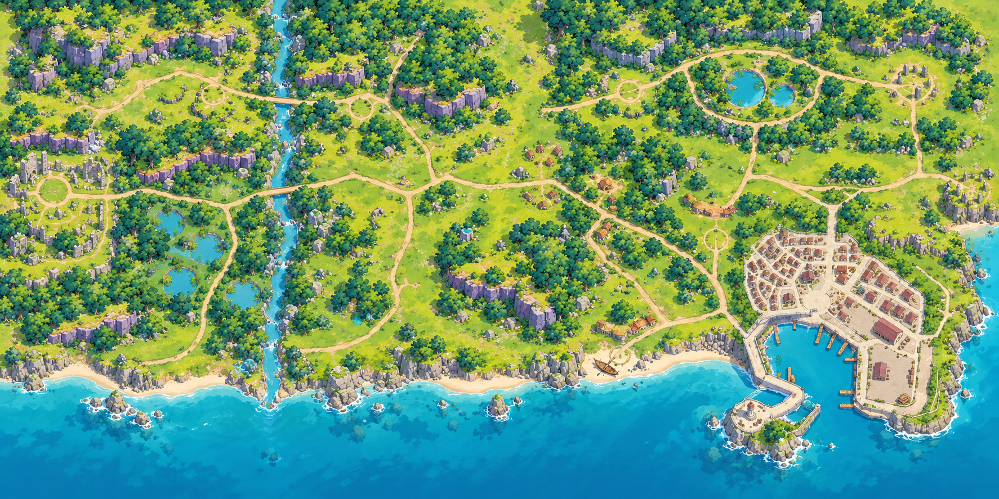
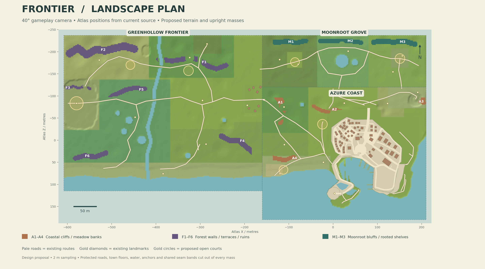
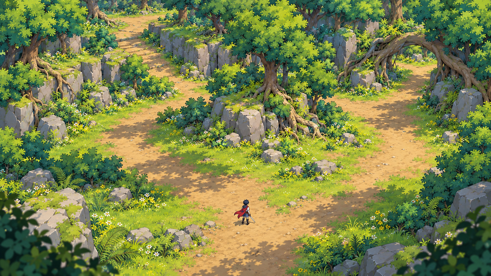
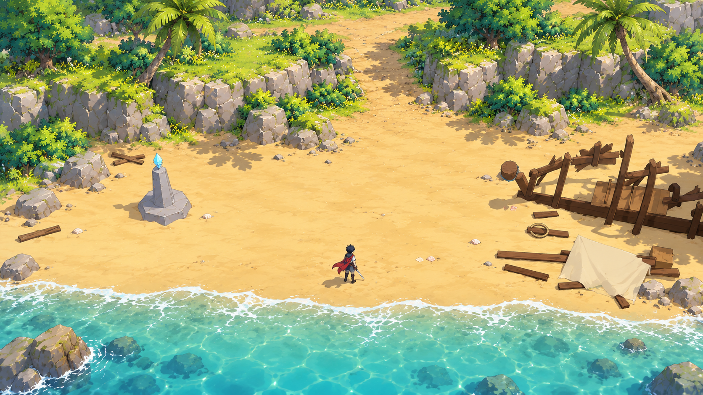
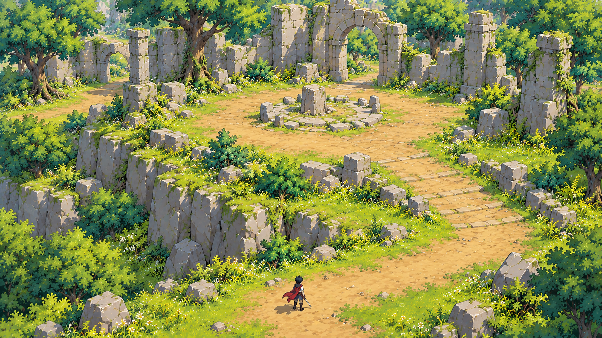

# แบบภูมิทัศน์ Frontier สำหรับกล้อง 40°

> ลงฉากในเกมแล้ว: [ดู implementation และภาพจากเกมจริง](IMPLEMENTATION.md) แบบต้นฉบับด้านล่างคงไว้เป็นข้อมูลอ้างอิง

วางผา แนวรากไม้ เรือนยอด และซากกำแพงให้เป็นมวลสูงด้านหลังหรือข้างพื้นที่เล่น สลับกับลานโล่ง ทางอ้อม และทางลาด เพื่อให้เห็นความลึกจากกล้องใหม่และยังอ่านการต่อสู้ได้ชัด

**สถานะ: ชุดแบบอ้างอิงสำหรับขึ้นฉาก 3D — มี implementation และภาพจากเกมในลิงก์ด้านบนแล้ว ยังไม่ merge หรือ deploy**

ฐานข้อมูลแมพ: main `6f3a7c237dc5323c7b94b2bdb3d7cd647c04d281` ส่วนกล้องใช้ข้อกำหนดที่เจ้าของเลือกใน [PR137](https://github.com/nerfmez/Demo---mmorpg/pull/137), head `ff8d525debf8ff2f8c2bf2dbd195e1fc2aa4c951`: มุมเงยจากพื้น 40°, ระยะ 23.3 ม., vertical FOV 36° ใน landscape / 52° ใน portrait ตามต้นทาง PR137 ยังไม่รวมเข้า main ณ เวลาตรวจ การออกแบบนี้ไม่คัดลอกโค้ดกล้องหรือเปิด look ทดลองของ Claude ซ้ำ

## ภาพรวมโลก



ภาพนี้แสดงภาษาภาพ การรวมกลุ่มต้นไม้ และจังหวะผาสลับพื้นที่เปิด โดยคงความสัมพันธ์ของ Greenhollow ด้านตะวันตก, Moonroot เหนือ Azure, เมืองท่าทางตะวันออกเฉียงใต้ และหาดเริ่มเกมทางตะวันตกของเมือง มุมบนใช้ตรวจภาพรวม พื้นที่เล่นแต่ละฉากออกแบบเพื่อกล้อง 40°

ภาพวาดมีการตีความเส้นฝั่งและรายละเอียดเล็กน้อย ใช้ผังพิกัดด้านล่างเป็นหลักเมื่อลงตำแหน่ง ห้ามใช้ตำแหน่งที่คาดจากพิกเซลภาพวาดแทนข้อมูลแมพ

## ผังอิงพิกัดจริง



- ถนนสีอ่อน เมือง พื้นน้ำ และจุดสังเกตอ่านจากข้อมูลแมพและ heightfield ที่เกมใช้จริง
- แนว A/F/M คือพื้นที่เสนอเพิ่มมิติ สีเป็นรหัสบนผัง ไม่ใช่สีวัสดุในเกม
- พื้นที่สีถูกตัดออกจากถนน พื้นเมือง น้ำ จุดเกิด จุดวาร์ป ลานบอส จุดสังเกต ลานเปิดที่เสนอ และแถบรอยต่อโลกเดิม การคำนวณบนผังใช้กริด 2 ม. เป็นเพียงการคัดพื้นที่เบื้องต้น ไม่ได้พิสูจน์เส้นทางเดินในเกม
- จุดสังเกตและทางเชื่อมคงอยู่ในระบบพิกัดเดิม (`atlas = native + atlas.offset`) โลกยังเป็นผืนเดียว

## ภาพฉาก

### ป่า — ผารากไม้และทางวน



ผาตัดสูงประมาณ 2.5–4.5 ม. รองรับต้นไม้และรากไม้ขนาดใหญ่ด้านหลัง แนวสูงแบ่งเป็นกลุ่มแทนการกระจายต้นไม้เดี่ยวทั่วพื้น ทางแยกอ้อมก้อนภูมิประเทศกลับมาบรรจบกัน ลานต่อสู้ประมาณ 18–22 ม. และด้านหน้ากล้องใช้วัตถุเตี้ย พื้นทางลาดเชื่อมกับดินจริง

ภาพนี้เป็นต้นแบบภาษารูปทรงสำหรับ F1/M1–M3 ไม่ใช่ผังย้ายจุด Root Arch จาก Moonroot ไป Greenhollow ภาพขยายพื้นที่ให้เห็นแนวคิดครบ ระยะเลนส์และความกว้างจริงต้องตรวจในเอนจิน ตัวละครในภาพเป็นหุ่นบอกสเกล ไม่ใช่คำสั่งเปลี่ยนโมเดลผู้เล่น

### หาด — ผาหลังทรายและทางลาดขึ้นบก



ใช้ผาหินกัดเซาะสูง 1.5–3 ม. หลังแนวทราย และต้นไม้บนดินด้านบน ซากเรืออยู่ขวา จุดวาร์ปอยู่ซ้าย ทางเริ่มเกมยังเชื่อมไปเมืองทางตะวันออก ทางขึ้นบกเปิดกว้าง หาดยังมีทรายให้ต่อสู้และเก็บของ ไม่มีหญ้าและดอกไม้บนทราย เปิดช่องทะเลด้านล่างเพื่อให้แยกฝั่งกับทางเดินชัด

### ซากโบราณ — กำแพงแตกและชั้นพื้น



ยึด plateau ซากโบราณเดิมเป็นฐาน ใช้แนวกำแพงแตกสูง 3–6 ม. กับ buttress บางช่วง สร้างกรอบด้านหลัง ลานบอสยังเปิด มีช่องทางเข้าและทางอ้อมมากกว่าหนึ่งทาง พื้นต่างระดับขึ้นได้ด้วยทางลาดยาว พื้นหินที่ดูคล้ายขั้นในภาพต้องทำผิวเดินต่อเนื่องตาม heightfield ของเกม ไม่เพิ่มข้อบังคับกระโดดหรือระบบเดินขึ้นบันไดใหม่

## การปรับแยกตามพื้นที่

ความสูงพื้นในตารางหมายถึงผลต่างจากพื้นล่างใกล้เคียง ไม่ใช่ค่าที่บวกทับ plateau เดิม ช่วงความสูงเป็นเป้าหมายออกแบบสำหรับลองในฉาก

| ผัง | พื้นที่ | แนวภูมิทัศน์ | ความต่างระดับพื้น |
| --- | --- | --- | --- |
| A1 | ป่าโปร่งริมฝั่ง | ผาสั้นและรากไม้ สลับช่องไปหอสังเกตการณ์ | 2–4 ม. |
| A2 | ทุ่งรอบเมือง | คันดิน แนวสวน กำแพงกันดินเตี้ย | 1–2.5 ม. |
| A3 | แหลมเหนือเมือง | แต่งแนวผาเดิมและไหล่หิน เคารพทางขึ้นศาล | 3–6 ม. |
| A4 | หาดผู้มาเยือน | ผาหลังหาด ช่องขึ้นบก และต้นไม้บนดิน | 1.5–3 ม. |
| F1 | ป่ารากตะไคร่ | ผารากไม้ใกล้ด้านหลังทางป่า มีลานกลางและทางแยก | 2.5–4.5 ม. |
| F2 | ที่ราบสูง | ชั้นผาสลับทางลาดและชะง่อนหิน | 4–8 ม. |
| F3 | ซากโบราณ | กำแพงแตก เสาค้ำ และช่องเปิด บน plateau เดิม | พื้นเดิม; กำแพง 3–6 ม. |
| F4 | ทุ่งพุ่มหนาม | สันดิน ป่าหนามเป็นกลุ่ม และลานล่า | 1.5–3 ม. |
| F5 | ที่ชุ่มน้ำ | โคกดินแห้งและต้นหลิวด้านหลัง ช่องเห็นน้ำชัด | 0.8–2 ม. |
| F6 | ชายฝั่งตะวันรอน | ไหล่ผาริมอ่าวเล็กและทางผ่านตามฝั่ง | 2–4 ม. |
| M1 | โพรงรากตุ่น | ผารากไม้ด้านเหนือ เคารพลานแคมป์และซุ้มรากเดิม | 2.5–4 ม. |
| M2 | สระกระจก | ผาหลังสระและแนวรากไม้ เคารพทางวนและจุดวาร์ป | 2–3.5 ม. |
| M3 | เนินเฟิร์น/วงหิน | ชั้นเฟิร์นกับผารากไม้ ลานแท่นบูชายังโล่ง | 2–4 ม. |

รายละเอียดแนวเส้น ความกว้าง และชุดชิ้นส่วนอยู่ใน [plan.json](plan.json) มี 13 แนวและ 7 ลานเปิด จุดประสงค์คือกำหนดตำแหน่งมวลฉาก ความสูง และขอบเขตที่ต้องหลบ ก่อนทำ geometry/collider จริง

## การขึ้นฉากให้ใช้จริง

1. เริ่ม F1 หรือ A4 เป็นพื้นที่ทดลองสั้น ๆ จากกล้อง PR137 ที่ 40° ปรับรูปทรงให้เห็นผาจริงที่ระยะเล่นปกติ แล้วจึงขยายอีก 12 แนว ห้ามใช้ภาพมุมบนอย่างเดียวอนุมัติการบังตัวละคร
2. ใช้ชิ้นส่วน 4/8 ม. ร่วมกัน: ผาตรง มุมเข้า/ออก ปลายลาด ฝาหญ้า รากไม้ โคนต้นไม้ กำแพงแตก และทางลาด สีวัสดุและเรือนยอดใช้ภาษาภาพเดิม ผิวเดินทั้งหมดอ่านจาก heightfield ร่วมกับ collision
3. แปลงแนวใน `plan.json` เป็น footprint ที่ปรับละเอียดแล้ว ลงแบบเดียวกันให้ทั้ง terrain/collider/rendering อย่าใช้หินภาพที่เดินทะลุได้ หรือใช้กล่อง collider ที่ไม่ตรงขอบผา รากโค้งเป็นของตกแต่งเหนือเส้นทางระดับพื้นได้ แต่ยังไม่ทำทางเดินซ้อนระดับใต้/บนกัน
4. คงถนน จุดวาร์ป จุดเกิด ทางเข้าเมือง บริการ NPC และจุดสังเกต ตำแหน่งปลูกเดิมที่อยู่ใน footprint ใหม่ต้องย้ายหรือคัดออกอย่างเจาะจง พร้อมตรวจ spawn และเส้นทางเควสใหม่ พื้นที่นอกงานไม่ควรสุ่มจัดใหม่ทั้งโลก
5. แยกกรอบสูงด้านเหนือ/ข้างลานจากของเตี้ยด้านใต้ ใกล้จุดเล่นที่ 40° วัตถุสูง `h` บังระยะบนพื้นคร่าว ๆ `h / tan(40°) ≈ 1.19h` ก่อนผล perspective; ผาสูง 4 ม. จึงอาจบังพื้นที่เกือบ 5 ม. ใช้เป็นค่าตั้งต้นเท่านั้น ต้องตรวจภาพจริงทั้งผู้เล่น ศัตรู วงเตือน ของดรอป และจุดแตะ
6. ใช้การลดการบังที่มีอยู่ใน `toon.js`/`patch.js` โดยตรวจด้วยว่าศัตรูและสัญญาณโจมติเห็นจริง ระบบปัจจุบันที่เปิดบริเวณผู้เล่นไม่ได้พิสูจน์ว่าจะเห็นทุกอย่างที่ซ่อนหลังของสูง
7. รวมวัสดุและชิ้นส่วนซ้ำ แบ่ง batch ตาม cell ที่ระบบเดิมใช้ และเตรียมตอนโหลดแรกเหมือน resident world หลีกเลี่ยงแผ่นใบไม้โปร่งใสซ้อนหนา วัสดุแยกต่อหิน และ geometry ผาที่ยาวคร่อมพื้นที่ใหญ่จนคัดออกยาก ยังไม่มีการวัด FPS หรือหน่วยความจำของฉากที่เสนอ
8. เมื่อลงเกมแล้วตรวจ world routes/collision, build, desktop/iPad Chromium/WebKit และภาพมุม 40° ตาม `AGENTS.md` เทียบภาพและตัวนับจากกล้องเดียวกัน ก่อน merge

เมือง V3 มีชั้นอาคารสูงในตัวอยู่แล้ว การออกแบบนี้เน้นขอบภูมิประเทศรอบเมืองและพื้นที่ล่า ไม่มีแผนย้ายเมืองหรือเปลี่ยนให้เป็นป้อมปราการ ส่วน `?look=cel`/`?look=frieren` ของ PR137 ยังเป็นตัวเลือกทดลอง การเลือกกล้อง 40° ไม่ได้ถือเป็นการอนุมัติ look เหล่านั้น

## หลักฐานที่อ่าน

- `data/world.json`, `data/maps/frontier-wilds.json`, `data/maps/moonroot-grove.json`, `data/city-v3.json`: ขอบโลก จุดเชื่อม ถนน ระดับพื้น เมือง และ landmark
- `src/core/world.js`, `terrain.js`, `city.js`, `unified-world.js`: footprint, ทางลาด, ความต่อเนื่องโลก และการสร้างสิ่งแวดล้อม
- `src/render/environment.js`, `nature.js`, `view.js`, `patch.js`, `src/ui/mapimage.js`: รูปทรงต้นไม้ หิน กล้อง และการอ่านแมพ
- ภาพใน `docs/review/unified-world/`, `docs/review/camp-medium/`, `docs/reference/target-gameplay-mock.png` และ `assets/moonroot/moonroot_grove_concept.jpg`
- [GGG: Interview with the Level Design Department](https://www.pathofexile.com/forum/view-thread/1654235): ใช้แนวคิดพื้นที่เผชิญหน้าที่แตกต่างกันและเชื่อมต่อกันเป็นแรงอ้างอิง
- [GGG: Path of Exile 2 Environment Art](https://www.pathofexile.com/forum/view-thread/3786417): อ้างอิงการอ่านมวลฉากและงานสภาพแวดล้อม การวางมวลสูงในแบบนี้เป็นการตีความเพื่อนำมาประยุกต์กับเกมเรา ไม่ใช่ข้อกำหนดจาก GGG และไม่ได้ใช้ asset ของ PoE

## ตรวจแบบและทำซ้ำ

ตรวจภาพต้นฉบับทั้งสี่และผังหลังแก้ label แล้ว: ป่ามีทางวนชัดและไม่มีวัตถุทับตัวละคร หาดมีแนวผาสูงด้านหลังแต่ทรายยังโล่ง ซากโบราณมีทางขึ้นสองระดับและช่องผ่าน ภาพรวมเก็บความสัมพันธ์เมือง/ชายฝั่ง/สระ/ทางเชื่อมได้ ผังรุ่นแรกมีชื่อ region ทับรหัส F2/M2 จึงเลื่อนชื่อขึ้นด้านบนและตรวจรุ่นสุดท้ายซ้ำ รายละเอียดการตรวจและ hash อยู่ใน [review.json](review.json)

ข้อจำกัด: ภาพเป็น concept raster ไม่ใช่ภาพ screenshot หลังลงเกม รูปทรงและความกว้างในภาพไม่ใช่ผลวัดจากกล้อง 3D ยังไม่ยืนยัน collision, navigation, การบังวงโจมตี หรือประสิทธิภาพบน iPad งานนี้เป็น design-only จึงไม่รันชุดทดสอบเกมที่ไม่เปลี่ยน

สร้างผังใหม่จาก root ของ repo:

```bash
node docs/design/landscape-40deg/export-basis.mjs /tmp/frontier-landscape-basis.json
python docs/design/landscape-40deg/render-plan.py /tmp/frontier-landscape-basis.json
```

ตัว export อ่านโค้ดเกมจริงและไม่แก้ source map ส่วน Python ต้องมี NumPy/Matplotlib/Pillow ผลหลักคือ `registered-plan.png` และ `placement-review.json` ภาพ concept สร้างด้วย built-in image generation; ดูชุดพรอมป์ต์สำหรับทำต่อใน [prompts.md](prompts.md)
