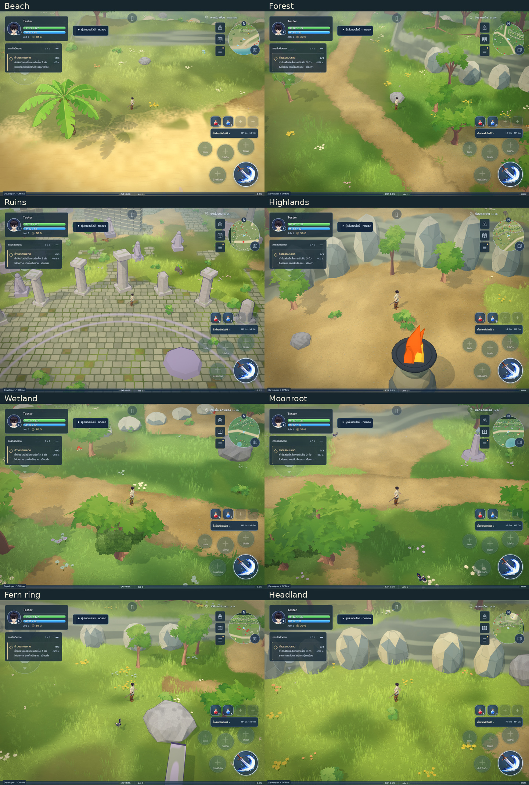

# ภูมิทัศน์กล้อง 40° — ภาพจากเกมจริง

ฉากรุ่นนี้อยู่บนสาขา `feat/layered-landscape-40deg-20261021` ยังไม่ merge หรือ deploy ภาพด้านล่างเป็น screenshot จาก production build ไม่ใช่ concept ภาพวาดเดิมอยู่ใน [ชุดแบบ](../../design/landscape-40deg/README.md)

เพิ่มแนวภูมิทัศน์ 13 แนวใน Azure, Greenhollow และ Moonroot: ผาและคันดินใช้ heightfield จริง ต้นไม้ขึ้นบนสันดิน รากยึดกับพื้น ก้อนหินและกำแพงมี collider และปรากฏบน minimap ถนนเดิม เมือง น้ำ จุดเกิดและทางเชื่อมภูมิภาคมีเขตเว้นว่าง กล้อง 40° มาจากการเลือกของเจ้าของใน PR137 โดยคงสไตล์เกมเดิม

| มุมตรวจ | ภาพ |
|---|---|
| ป่าก่อนปรับ กล้อง 40° | [ก่อน](forest-before.png) |
| ป่าหลังปรับ | [หลัง](forest-wide.png) |
| ชายหาด | [เปิด](beach-wide.png) |
| ซากโบราณ | [เปิด](ruins-wide.png) |
| ที่ราบสูง | [เปิด](highlands-normal.png) |
| Moonroot | [เปิด](moonroot-normal.png) |
| ตัวละครหลังแนวผา | [เปิด](forest-rear-visibility.png) |
| จอมือถือแนวนอน | [เปิด](phone-forest.png) |
| จอแท็บเล็ตแนวตั้ง | [เปิด](portrait-forest.png) |
| Desktop | [เปิด](desktop-forest.png) |

ตรวจ core ผ่าน 593/593 และ build ผ่าน ตรวจภาพจากเกม 16 มุม พร้อมจอยสัมผัสจริงใน Chromium: ตัวละครขยับและหยุดเมื่อปล่อยนิ้ว ตรวจการชน/ความสูงถนน จุดเกิดและรอยต่อโลก รวมถึงการหาจุดยืนใหม่จากเซฟที่ทับสิ่งกีดขวาง และการคืน geometry/material ผ่าน

ตอนตรวจภาพพบผิวผาเป็นแผ่นสามเหลี่ยมแข็งและก้อนหินลอยเหนือด้านลาด แก้ด้วยผิว terrain เดียวและฝังฐานหินกับระดับต่ำสุดรอบก้อนแล้ว ตัวละครยังมองเห็นผ่าน dither เมื่ออยู่หลังผาและเรือนยอด วัสดุพื้นผายังคงลักษณะนุ่มและรากโคนต้นไม้ยังเป็นรูปทรง low-poly ของเกมเดิม

ผลนี้เป็นการตรวจบน software GL ไม่มีผล FPS จาก iPad จริง และยังไม่รับรอง WebKit/การเล่นครบทุกเมตร ก่อน merge ต้องผ่าน CI Chromium/WebKit และตรวจบน iPad ของเจ้าของ รายละเอียด source, hash, มุมกล้อง, draw counters และข้อจำกัดอยู่ใน [review.json](review.json) การนับ render เป็นค่าจากมุมตรวจเดียวกันโดยประมาณ ไม่ใช่ผลวัดความเร็วของอุปกรณ์
